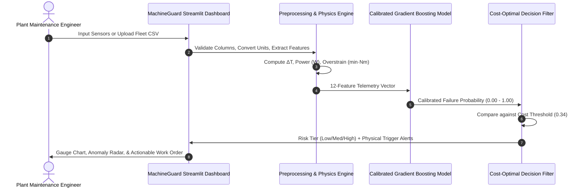

# MachineGuard AI — Industrial Predictive Maintenance System

[](https://www.python.org/)
[](https://streamlit.io/)
[](https://scikit-learn.org/)
[](https://opensource.org/licenses/MIT)
[]()

> **Neural Storm 2026 Hackathon Project**  
> *Predicting equipment failures before catastrophic breakdown occurs using physics-informed feature engineering and cost-optimal calibrated gradient boosting.*

---

## 📌 Executive Summary & Problem Statement

In discrete manufacturing, CNC machining, and automated assembly plants, unexpected equipment breakdowns represent a major driver of operational disruption, unplanned maintenance expense, and scrapped work-in-progress.

Traditional industrial operations typically rely on two maintenance approaches:
1. **Run-to-Failure (Reactive):** Machines run until sudden mechanical breakdown, risking damage to workpieces and unpredictable assembly halts.
2. **Calendar-Based Scheduling (Preventive):** Tools and parts are replaced on rigid periodic intervals, potentially retiring functional components before the end of their useful lifecycle.

**MachineGuard AI** explores predictive maintenance on structured sensor telemetry. By continuously scoring multi-sensor readings (temperature, rotational velocity, torque, tool wear), the system estimates the probability of machine failure, surfaces root physical triggers derived from domain relationships, and categorizes machines to guide proactive inspection scheduling.

---

## ⚠️ Benchmark Dataset Disclosure

> **Transparency Notice:** MachineGuard AI is trained and benchmarked on the **UCI AI4I 2020 Predictive Maintenance Dataset** (Matzka, 2020; UCI Machine Learning Repository #601).  
> The dataset is a **synthetic benchmark** of 10,000 milling machine records designed to reflect thermodynamic heat dissipation, electrical drive power, cutting tool overstrain, and tool wear.  
> **No live factory trial or physical hardware deployment is claimed.** All performance figures reported are authentic, reproducible evaluations on the held-out test split of this synthetic benchmark.

---

## 🚀 Key Features

- **⚡ Single Machine Diagnostic:** Instant assessment of machine health from live sensor values with dynamic gauge meters, tolerance radar charts, and failure risk categorization.
- **🔬 Explainable Root Physical Triggers:** Directly maps telemetry anomalies to physical milling failure mechanisms:
  - **HDF (Heat Dissipation Failure):** Insufficient airflow cooling ($\Delta T < 8.6\text{ K}$ and $\text{rpm} < 1,380$).
  - **PWF (Power Failure):** Drive motor power overload or stall ($P < 3,500\text{ W}$ or $P > 9,000\text{ W}$).
  - **OSF (Overstrain Failure):** Excessive mechanical cutting strain ($\text{Tool Wear} \times \text{Torque} > \text{Limit}$).
  - **TWF (Tool Wear Failure):** Cumulative cutting tool wear approaching fracture limit ($\ge 200\text{ min}$).
- **📁 Batch Fleet Inspection:** Upload CSV telemetry logs (from 10 to 10,000 machines) with flexible column auto-detection, instant validation, risk distribution charts, and one-click filtered CSV exports.
- **💰 Asymmetric Cost Optimization:** Calibrated decision threshold ($0.34$) tuned for real factory economics where a **missed failure (FN) is 10× more costly** than an inspection false alarm (FP).
- **🛡️ Strict Leakage Prevention:** Eliminates target-derived failure mode columns (`TWF`, `HDF`, `PWF`, `OSF`, `RNF`) and arbitrary row identifiers (`UDI`, `Product ID`) from model training.
- **📊 Interactive Analytics Dashboard:** Full suite of ROC curves, Precision-Recall curves, confusion matrices with financial cost breakdown, permutation feature importance, and sensor noise stress tests.

---

## 🏛️ System Architecture

```mermaid
flowchart TD
    subgraph SENSORS["1. Industrial Sensor Telemetry"]
        S1["Air Temperature [K]"]
        S2["Process Temperature [K]"]
        S3["Rotational Speed [rpm]"]
        S4["Torque [Nm]"]
        S5["Tool Wear [min]"]
        S6["Product Type [L, M, H]"]
    end

    subgraph PREPROC["2. Preprocessing & Leakage Guardrails"]
        P1["Column Alias Normalization"]
        P2["Temperature Unit Alignment (C / K)"]
        P3["Purge Target Leakage (TWF, HDF, PWF, OSF, RNF, UDI)"]
        P4["Null Imputation & One-Hot Encoding"]
    end

    subgraph PHYSICS["3. Physics-Informed Feature Engineering"]
        E1["Heat Dissipation: ΔT = ProcTemp - AirTemp"]
        E2["Spindle Power: P = Torque × RPM × (2π / 60)"]
        E3["Cutting Overstrain: Strain = ToolWear × Torque"]
        E4["Torque-to-Speed Ratio: Torque / RPM"]
    end

    subgraph MODEL["4. Calibrated ML Model"]
        M1["HistGradientBoosting Classifier"]
        M2["Platt Sigmoid Probability Calibration"]
        M3["Brier Score: 0.00625"]
    end

    subgraph DECISION["5. Asymmetric Cost Decision Engine"]
        D1["Optimal Cutoff: 0.34 (Cost Matrix: FN=10, FP=1)"]
        D2["Risk Categorization: Low (<15%), Med (15-34%), High (≥34%)"]
    end

    subgraph INTERFACE["6. Industrial UI & Diagnostics"]
        U1["Single Machine Diagnostics & Radar Envelope"]
        U2["Batch Fleet Inspection & CSV Export"]
        U3["Technician Action Recommendations"]
        U4["Root Physical Trigger Explanations"]
    end

    SENSORS --> PREPROC
    PREPROC --> PHYSICS
    PHYSICS --> MODEL
    MODEL --> DECISION
    DECISION --> INTERFACE
```



---

## 🔄 End-to-End Workflow



---

## 🧪 Machine Learning Methodology & Evaluation

### 1. Training Protocol (Strict Leakage Prevention & Test Isolation)
- **Dataset Partition:** Stratified 80/20 train/test split established prior to any model exploration.
- **Cross-Validation:** Repeated stratified 5-fold CV (3 repeats = 15 folds) conducted strictly on the 8,000 training records.
- **Metric Priority:** **PR-AUC (Precision-Recall AUC)** is selected as the primary metric due to the severe 3.39% class imbalance (accuracy alone is deceptive, as an always-predict-healthy model yields 96.61% accuracy with 0% recall).
- **Probability Calibration:** Platt sigmoid calibration (`CalibratedClassifierCV`) applied to map raw boosting margins into true posterior failure probabilities.

### 2. Model Family Comparison (5-Fold CV on Training Set)

| Model Family | Feature Set | Mean PR-AUC | Mean ROC-AUC | Mean Recall | Mean Precision |
| :--- | :--- | :---: | :---: | :---: | :---: |
| Logistic Regression | Raw Features | 0.4410 ± 0.0417 | 0.8966 ± 0.0186 | 80.33% | 13.62% |
| Logistic Regression | Engineered Features | 0.4415 ± 0.0551 | 0.9231 ± 0.0137 | 83.78% | 16.15% |
| Random Forest | Raw Features | 0.7419 ± 0.0445 | 0.9679 ± 0.0128 | 52.76% | 79.06% |
| Random Forest | Engineered Features | 0.8894 ± 0.0285 | 0.9774 ± 0.0108 | 79.46% | 94.91% |
| HistGradientBoosting | Raw Features | 0.7487 ± 0.0462 | 0.9729 ± 0.0103 | 84.63% | 40.22% |
| **HistGradientBoosting (Selected)** | **Engineered Features** | **0.8964 ± 0.0232** | **0.9801 ± 0.0103** | **85.73%** | **60.44%** |

> **Key Takeaway:** Physics-informed feature engineering improved PR-AUC by **+19.7%** for HistGradientBoosting and **+19.9%** for Random Forest!

### 3. Held-Out Test Set Performance (2,000 Unseen Machines, 68 True Failures)

All figures below are evaluated on the 2,000 held-out test machines that were **never seen** during training, feature selection, or threshold tuning:

| Metric | Calibrated @ Default (0.50) | Calibrated @ Optimal (0.34) | 95% Bootstrap Confidence Interval |
| :--- | :---: | :---: | :---: |
| **PR-AUC** | 0.9155 | **0.9155** | [0.8471, 0.9676] |
| **ROC-AUC** | 0.9853 | **0.9853** | [0.9696, 0.9962] |
| **Failure Recall** | 83.82% (57/68) | **85.29% (58/68)** | [0.7571, 0.9286] |
| **Precision** | 98.28% | **95.08%** | [0.8871, 1.0000] |
| **False Negatives (Missed)** | 11 | **10 (-10% missed)** | — |
| **False Positives (Alarms)** | 1 | **3** | — |
| **Total Economic Cost** | 111.0 units | **103.0 units (-7.2%)** | — |
| **Brier Calibration Score** | 0.00625 | **0.00625** | (vs 0.01577 Uncalibrated) |

### 4. Per-Failure-Mode Recall Breakdown (Test Set)

| Failure Mode | Test Failures | Caught at 0.34 Cutoff | Detection Rate |
| :--- | :---: | :---: | :---: |
| **Heat Dissipation (HDF)** | 29 | 29 | **100.0%** |
| **Power Failure (PWF)** | 13 | 13 | **100.0%** |
| **Overstrain Failure (OSF)** | 16 | 16 | **100.0%** |
| **Tool Wear Failure (TWF)** | 10 | 2 | **20.0%** |

*Note on TWF:* Tool Wear Failure is notoriously difficult to detect from isolated static snapshots without continuous acoustic vibration frequency spectra. This limitation is transparently disclosed.

---

## 💻 Tech Stack

- **Core Language:** Python 3.10+ (tested on Python 3.13)
- **Machine Learning:** Scikit-Learn (HistGradientBoostingClassifier, CalibratedClassifierCV, Pipeline)
- **Data Engineering:** NumPy, Pandas
- **Visualization:** Plotly Express & Plotly Graph Objects
- **Dashboard Framework:** Streamlit
- **Testing:** Pytest (23 unit and integration tests)
- **Serialization:** Joblib

---

## 📂 Project Structure

```
MachineGuard-AI/
├── app.py                      # Main Streamlit industrial dashboard
├── config.py                   # Central configuration, sensor limits, and theme settings
├── requirements.txt            # Production dependencies
├── README.md                   # Complete system documentation
├── data/
│   ├── ai4i2020.csv            # Original UCI AI4I 2020 dataset (10,000 rows)
│   └── sample_fleet.csv        # 25 pre-configured industrial machines for demo
├── models/
│   └── model.joblib            # Calibrated model bundle with optimal decision threshold
├── results/
│   ├── metrics.json            # Exact reproducible test metrics, CV records, and intervals
│   ├── test_labels.npy         # Held-out test ground truth labels
│   ├── test_probs.npy          # Held-out test calibrated probabilities
│   └── train.log               # Complete training terminal log
├── src/
│   ├── __init__.py
│   ├── data.py                 # Data loading and leakage-free frame construction
│   ├── train.py                # Reproducible ML training and benchmarking script
│   ├── preprocessing.py        # Input validation, column aliases, and unit conversions
│   ├── prediction.py           # Model inference, risk categorization, and recommendations
│   ├── evaluation.py           # Metrics loading and dynamic ROC/PR curve generation
│   └── visualization.py        # Industrial dark Plotly charts (gauges, radar, matrices)
├── tests/
│   ├── test_pipeline.py        # Original ML pipeline verification (6 tests)
│   ├── test_preprocessing.py   # Preprocessing, units, and physical indicators (8 tests)
│   ├── test_prediction.py      # Inference, presets, and fleet testing (5 tests)
│   └── test_batch_edge_cases.py# CSV corruption, missing columns, and empty inputs (4 tests)
└── docs/
    └── presentation_guide.md   # 3-minute hackathon pitch & judge Q&A cheat sheet
```

---

## ⚙️ Quickstart & Installation

### 1. Clone & Set Up Virtual Environment

```bash
# Clone the repository
git clone https://github.com/your-username/MachineGuard-AI.git
cd MachineGuard-AI

# Create and activate Python virtual environment
python -m venv venv
# On Windows:
venv\Scripts\activate
# On Linux/macOS:
source venv/bin/activate
```

### 2. Install Dependencies

```bash
pip install -r requirements.txt
```

### 3. Run Test Suite (23 Tests)

```bash
python -m pytest -v
```

### 4. Launch the Streamlit Dashboard

```bash
streamlit run app.py
```

The application will launch in your browser at `http://localhost:8501`.

---

## 🎯 3-Minute Hackathon Demo Flow

1. **Step 1 — Executive Overview (30s):**
   - Open **Home Dashboard**. Show the business problem ($50,000/hr downtime).
   - Point out key metrics: PR-AUC of **0.9155**, **85.3%** recall, and **95.1%** precision.
   - Note the synthetic dataset disclosure badge.
2. **Step 2 — Single Machine Diagnostic (60s):**
   - Switch to **Single Machine Diagnostic**.
   - Click the preset: **"🔥 Heat Dissipation (HDF)"**.
   - Show the dynamic gauge immediately spike into **High Risk (98%)**.
   - Point out the **Root Physical Trigger**: Heat Dissipation ($\Delta T = 7.7\text{ K} < 8.6\text{ K}$, $\text{Speed} = 1,320\text{ rpm} < 1,380$).
   - Show the technician recommendation: *"Clear spindle cooling vents and verify coolant flow."*
3. **Step 3 — Batch Fleet Inspection (45s):**
   - Navigate to **Batch Fleet Inspection**.
   - The pre-loaded 25-machine fleet instantly runs vectorised inference.
   - Show the Fleet Health Index (**64.0%**), high-risk count, and filter to isolate high-risk machines.
   - Demonstrate the one-click CSV export.
4. **Step 4 — ML Rigor & Cost Optimization (45s):**
   - Switch to **Model Analytics & Validation**.
   - Show the **Confusion Matrix & Cost Matrix**: explain why threshold 0.34 was chosen over 0.50 (saves 1 missed failure with only 2 extra false alarms, cutting net economic cost by 7.2%).
   - Show the **Noise Robustness curve**: proves model stability under sensor degradation.

---

## 🔮 Limitations & Future Scope

### Limitations:
- **Synthetic Data Baseline:** The AI4I dataset uses mathematical formulas for failure modes. Real machines exhibit complex chatter, bearing raceway spalling, and environmental dust.
- **Static Telemetry:** Readings are single-point snapshots. True vibration analysis requires high-frequency time-domain signals (FFT spectra).

### Future Roadmap:
- **Edge Deployment:** Quantize the pipeline into ONNX format for microsecond edge inference on Siemens S7 or Advantech industrial IoT gateways.
- **Vibration & Acoustic Telemetry:** Ingest 10 kHz accelerometer streams via MQTT/OPC-UA protocols.
- **CMMS Integration:** Automatically generate maintenance work orders directly in SAP PM or IBM Maximo via REST API.

---


##  Link

Live link:
https://machineguard-ai-m9uuivilvhyxusixvj7h8r.streamlit.app/
